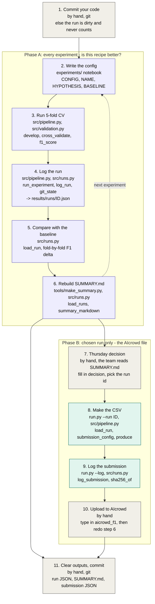
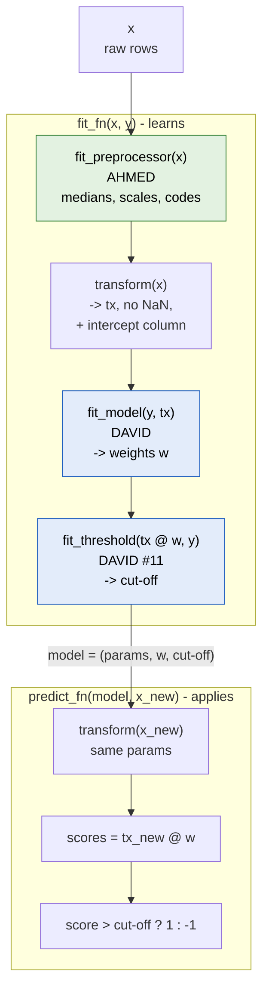
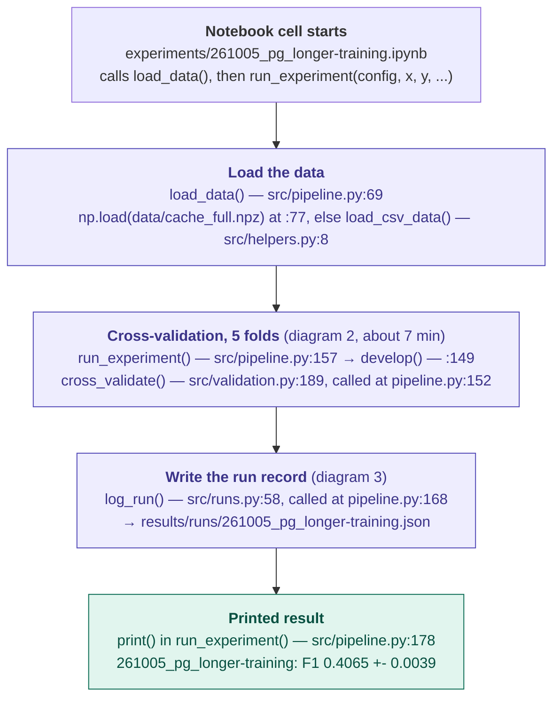
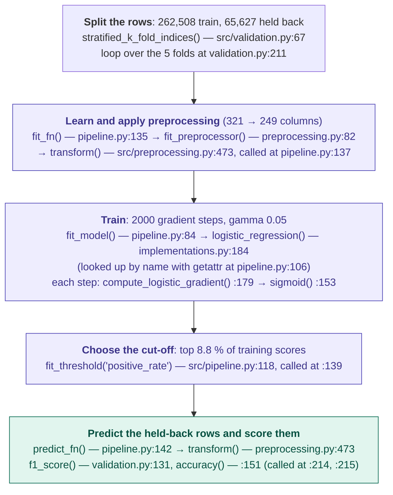
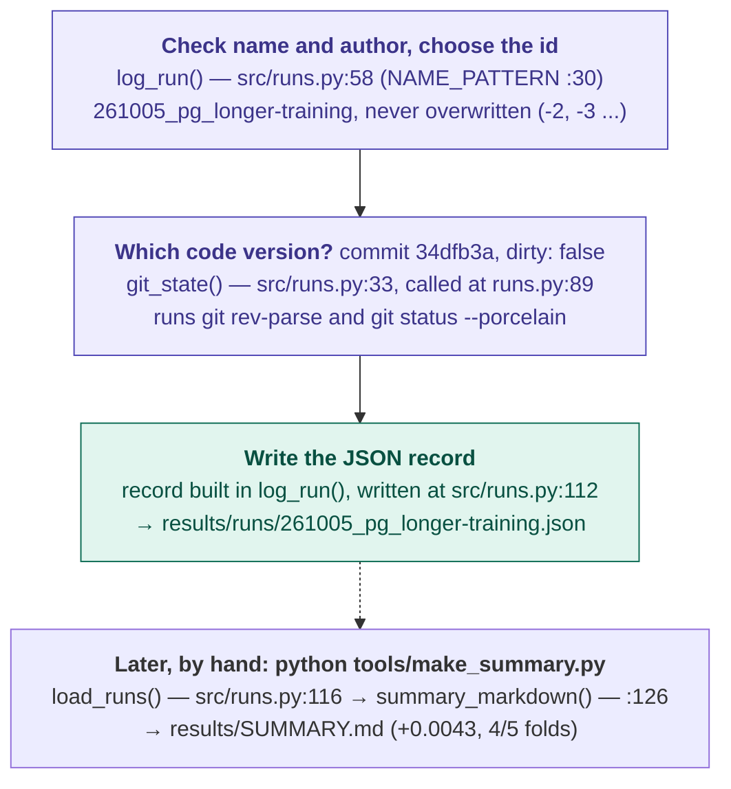

# The pipeline — how a score and a submission are made

Everything runs through one file, [`src/pipeline.py`](../src/pipeline.py), driven by
one config dict. Each of us owns one part of it, so we can work in parallel and
every score still comes out of the same harness and is comparable.

| Who | Owns | File | Config key |
|---|---|---|---|
| Ahmed | preprocessing: missing values, codes, encodings, features | `src/preprocessing.py` | `"preprocessing"` |
| David | the six methods; the threshold rule (#11) | `implementations.py` | `"model"`, `"threshold"` |
| Peter | the chain itself, CV harness, tests, `run.py` | `src/pipeline.py`, `src/validation.py`, `tests/` | — |

## The whole process: a complete run in 11 steps

Gray steps are done by hand. Most of the time you only loop through steps 2–6:
change one thing, score it, compare. Phase B runs a few times in the whole
project, only for the run the team picked. The notebook
[`experiments/261004_pg_full_run.ipynb`](../experiments/261004_pg_full_run.ipynb, not included here)
has one cell per step from 2 to 9.

The same diagram as an image: [flow_11_steps.svg](flow_11_steps.svg). With the
file and the functions behind every step, including the inside of `fit_fn` and
`predict_fn`: [flow_complete_run_functions.svg](flow_complete_run_functions.svg).



Step 8 stops before writing anything when the run is dirty or used
`implementations_pg`, when the fit diverges, or when the full-data fit scores
far below the run's CV F1.

## Inside `fit_fn` and `predict_fn`

The same four steps run in Phase A (once per fold) and Phase B (once on all
rows). Everything is **learned from the training rows only** and then applied
unchanged to the rows being predicted — that is what keeps the CV score honest.



## Trying your change

From the repo root, with the data in `data/`:

```python
from src.pipeline import BASELINE, load_data, develop

x_train, x_test, y_train, train_ids, test_ids = load_data()

config = {
    "preprocessing": {"one_hot": True},          # Ahmed: options of fit_preprocessor
    "model": {"name": "logistic_regression",     # David: any of the six methods
              "max_iters": 500, "gamma": 0.05},
    "threshold": "positive_rate",                # or "zero"; #11 adds better rules
}
result = develop(config, x_train, y_train)       # ~1-2 min on all rows
print(result["f1_mean"], result["f1_std"], result["f1_folds"])
```

`python -m src.pipeline` runs the baseline: **F1 0.3946 +- 0.0039** (MSE gradient
descent, 200 steps, gamma 0.05, positive-rate threshold). Compare your result
with that, on the same folds.

Good to know:

- **Labels:** the data has y in {-1, 1}. The pipeline converts to {0, 1} for the
  two logistic methods by itself — your functions receive what they expect.
- **`initial_w`** is always zeros, sized to the preprocessed matrix; a config
  never needs to know how many columns preprocessing produces.
- **Step size:** MSE gradient descent warns when gamma is too large to converge
  (gamma must stay below 2/L).

## What happens when you run an experiment

The three diagrams follow one call of `run_experiment` from a notebook cell, with
the function that does each step and where it lives. Example: the run
`261005_pg_longer-training` (logistic regression, 2000 steps). Line numbers are
those of `main` at commit `34dfb3a`; they shift when the files change, the
function names do not.

### 1. The whole cell



### 2. Inside one fold (runs 5 times)



Everything in boxes 2–4 is learned from the 262,508 training rows only; the
held-back rows are just transformed and scored. After the 5th fold,
`cross_validate` returns the five F1 values and `develop` adds the runtime.

### 3. Logging the run



The last step is not part of the cell: run it yourself after one or more runs,
then commit the new JSON files together with `results/SUMMARY.md`.
